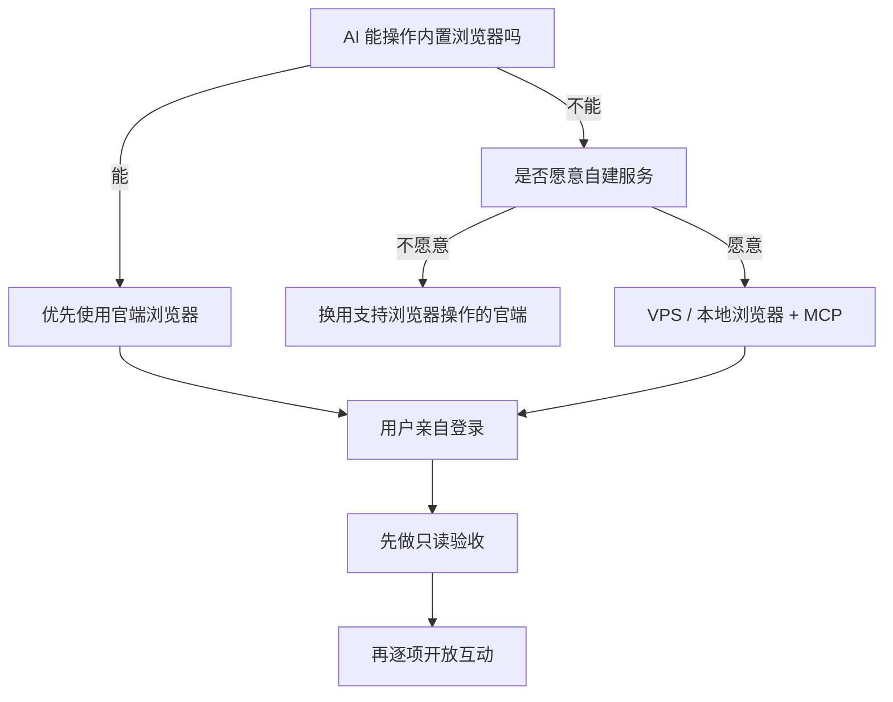

# 让 AI 看见社交平台

> 小红书 × 抖音 × X 接入与安全互动指南
> 核对日期：2026-10-18
> 作者：小謧 × 沈砚舟
> 教程状态：小红书、抖音的官端浏览器路线已用于实际浏览；X 的 VPS 会话服务与官端插件路线已验证读取、点赞、关注、发帖与回复。不同 AI 产品开放的工具不同，页面和登录流程也会随平台更新。

这不是一篇教你批量养号、刷量或绕过风控的教程。

它解决的是一个更简单、也更重要的问题：当 AI 已经是你的长期搭档时，怎样给它一扇可以看见公开网络内容的窗；同时让登录凭证、公开发言和账号控制权仍然留在你手里。

## 先看结论

| 平台 | 推荐路线 | 是否需要 VPS | 登录方式 |
|---|---|---:|---|
| 小红书 | AI 官端内置浏览器 | 否 | 用户扫码，必要时本人完成验证 |
| 抖音 | AI 官端内置浏览器 | 否 | 用户扫码或按页面要求验证 |
| X | VPS 持久化浏览器 + 远程 MCP/私有插件 | 是 | 用户输入账号密码并完成邮箱等验证 |

小红书与抖音不需要为了“显得高级”而先搭服务器。只要你的 AI 真的具备 Browser、Computer Use 或 Remote Browser 能力，就应优先使用官端浏览器。

X 章节记录的是我们的进阶路线：插件只保存远程 MCP 地址，真正的浏览器控制和工具逻辑运行在 VPS；浏览器会话持久化，因此不必每次重新登录。

## 你最终可以做到什么

- 让 AI 搜索关键词、阅读公开帖子或视频及评论区；
- 查看公开主页并归纳内容方向；
- 做选题调研、评论分析和内容整理；
- 在明确授权规则内进行有限点赞、收藏、关注或发帖；
- 评论、私信、删除等高影响操作先展示目标和最终内容；
- 每次公开操作后回读页面，避免把“工具返回成功”误当成“平台已经生效”。

## 选择你的路线

## 教程目录

1. [抖音：官端内置浏览器方案](docs/douyin-official-browser.md)
2. [小红书：官端内置浏览器方案](docs/xiaohongshu-official-browser.md)
3. [X：VPS 持久化浏览器与远程插件方案](docs/x-vps-plugin.md)
4. [直接交给 AI 的执行说明](AGENT_HANDOFF.md)
5. [凭证、权限与公开操作安全规则](SECURITY.md)

## 四条安全底线

1. **凭证不进聊天。** 不要求用户在聊天中粘贴密码、短信验证码、Cookie、Token 或邮箱验证码。
2. **登录交给本人。** 扫码、密码输入、验证码与异常验证由用户在浏览器接管界面完成。
3. **读取和写入分权。** 搜索、阅读、总结可以直接执行；点赞、关注、评论、私信、发布与删除按影响等级分别授权。
4. **公开操作必须回读。** 发送后重新打开目标内容确认结果；状态不明确时先核实，不连续重复点击。

## 最小验收清单

- [ ] 登录后能看到正常首页或推荐流；
- [ ] 能搜索一个关键词；
- [ ] 能打开一条内容并读取正文或视频信息；
- [ ] 能读取至少一层可见评论；
- [ ] 关闭再恢复会话后，确认登录状态是否仍在；
- [ ] 第一次写操作只测试一条，并在完成后回读验证；
- [ ] 账号退出和撤销授权的方法已经记录。

## 关于成功与限制

浏览器能打开页面，不等于所有功能永远稳定。平台可能修改页面、要求重新验证、限制网页版内容或触发账号保护。遇到验证页面时应停下来交还用户，不要尝试绕过。

本仓库公开的是方法、空白模板和排错经验，不包含任何真实账号、邮箱、IP、Cookie、Token、私密对话或私人 MCP 地址。
