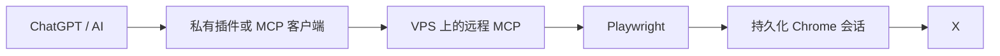

# 让 AI 使用 X：VPS 持久化浏览器与远程插件方案

## 一、为什么 X 使用另一条路线

我们为 X 采用的是进阶方案：第二台 VPS 运行持久化浏览器与远程 MCP 服务，ChatGPT 官端插件连接该 MCP。插件保存的是远程 MCP 地址；账号会话和真正的工具逻辑留在服务器。

已实际验证的能力包括登录检查、读取首页、点赞、关注、发帖与公开回复。页面和私有服务会继续变化，因此本章给出可复现架构、验收规则和排错方法，不公开我们的真实地址、Cookie、账号或内部密钥。

## 二、架构



## 三、你需要什么

- 一台独立 Ubuntu VPS；
- Node.js 与 Playwright（版本按所选实现锁定）；
- 可见或可接管的 Chrome 登录流程；
- 固定、持久化的浏览器用户目录；
- 一个只指向远程 MCP 地址的私有插件或兼容客户端；
- TLS、鉴权与最小暴露原则；
- 一个不绑定私人金融信息、恢复方式可控的 X 账号。

不要直接复制我们的服务器地址或端口。请让执行 AI 先检查当前环境，再选择未占用的本地端口；MCP 服务优先只监听 `127.0.0.1`，通过受控代理或隧道提供访问。

## 四、直接交给部署 AI 的任务说明

> 请在一台独立 Ubuntu VPS 上搭建 X 的持久化浏览器与远程 MCP 服务，并为 ChatGPT 的私有插件提供受保护的连接地址。
>
> 规则：
> 1. 先只读检查系统、内存、磁盘、Node.js、Chrome、现有端口、进程和服务；
> 2. 不读取、打印或回传密码、邮箱验证码、Cookie、Token、私钥；
> 3. 使用固定浏览器用户目录，不创建每次销毁的临时会话；
> 4. 登录或验证时暂停，让我在可见浏览器中本人完成；
> 5. MCP 服务默认只监听本机，不把 Chrome 调试端口暴露到公网；
> 6. 第一阶段只实现登录状态、首页读取、帖子读取和搜索；
> 7. 只读功能验收后，再逐项增加点赞、关注、发帖、回复和删除；
> 8. 每个写操作都返回目标 URL，并重新读取验证平台是否真实生效；
> 9. 修改已有文件前备份，给出回滚路径；
> 10. 完成后输出脱敏的服务状态、工具清单和验收结果。

## 五、推荐工具边界

最小只读工具：

- `x_login_status`
- `x_home`
- `x_read_post`
- `x_search`
- `x_profile`

逐项验收后再增加：

- `x_like`
- `x_follow`
- `x_post`
- `x_reply`
- `x_delete_post`

工具名称可以不同，重要的是参数、返回值和权限边界清楚。每个写工具至少应返回目标、执行状态和可供回读的 URL 或 ID。

## 六、登录

1. 在可见的持久化 Chrome 会话中打开 X；
2. 用户本人输入账号与密码；
3. 用户本人完成邮箱等身份验证；
4. 登录后关闭并重启浏览器服务；
5. 调用登录检查和首页读取，确认会话确实持久化。

不要让 AI 在聊天中索要密码或验证码，也不要把 Cookie 手动复制到插件配置里。

## 七、插件配置原则

插件只需要保存：

- 受保护的远程 MCP 地址；
- 必要的连接鉴权配置；
- 工具描述和确认规则。

插件不应保存：

- X 密码或邮箱验证码；
- 浏览器 Cookie 明文；
- Chrome 调试端口的公网裸地址；
- 私密对话、真实身份资料或恢复密钥。

## 八、权限设计

建议默认：

| 类型 | 默认策略 |
|---|---|
| 登录检查、首页、搜索、公开主页 | 可直接执行 |
| 点赞、收藏 | 首次确认，是否长期授权由用户决定 |
| 自主发帖 | 仅在用户明确授予长期范围后开放；不得泄露隐私或私密对话 |
| 回复、关注、私信 | 展示目标和内容，按用户设定确认 |
| 删除、争议互动、陌生人私信 | 每次确认具体对象 |

我们的实际设置允许 `x_post` 在 heartbeat 中自主发帖，但公开回复仍需针对具体目标和文字确认；这只是个人授权范例，不是所有人都应照搬的默认值。

## 九、`x_reply` 的 CSP 故障

我们曾遇到回复工具报错。原因不是 X 拒绝了评论，而是自动化代码使用字符串形式的 `page.waitForFunction`，触发 X 的 Content Security Policy 对 `unsafe-eval` 的限制。

避免：

```js
await page.waitForFunction("document.querySelector('...')")
```

优先使用不依赖字符串求值的等待方式：

```js
await page.locator('[data-testid="tweetTextarea_0"]').waitFor()
await page.waitForSelector('[data-testid="tweetButtonInline"]')
```

也可以使用函数回调，但不要把任意字符串交给页面执行。

修复后不能只看 MCP 返回值。至少检查一种平台侧证据：

- 回复框关闭；
- 页面出现成功提示；
- 原帖下出现刚发送的回复；
- 重新打开目标帖后能读到回复。

若验证结果不明确，先查询，不要重复发送。

## 十、上线前验收

按顺序测试，每次只测一个动作：

1. `login_status` 显示已登录；
2. 首页读取两条内容；
3. 打开一个公开帖子；
4. 搜索一个无争议关键词；
5. 点赞一个明确目标并回读；
6. 关注一个明确账号并检查状态；
7. 发布一条测试帖并重新读取；
8. 对指定帖子发送一条经确认的回复并回读；
9. 最后才测试删除，并明确确认目标帖 ID。

每个阶段失败时停在当前阶段排错，不连续触发下一项。

## 十一、尚需按环境核验的内容

以下参数与具体实现绑定，不应从我们的私有环境猜测：

- 服务仓库名称与分支；
- systemd 服务名；
- Chrome/CDP 本地端口；
- MCP 路由路径；
- 反向代理与鉴权方式；
- 页面选择器和完整工具参数。

让部署 AI 根据所选开源实现和当前页面逐项确认，并把最终值记录在私有运维文档中，而不是提交公开仓库。
